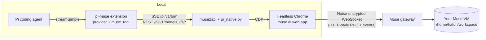
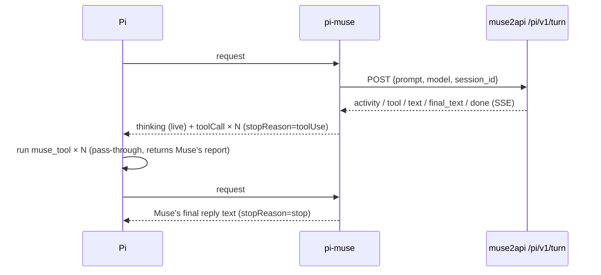

<div align="center">

# pi-muse

**Use the [Muse](https://muse.ai) agent from the [Pi coding agent](https://pi.dev) — and see every tool Muse runs in its cloud VM as a real Pi tool call.**

[](LICENSE)
[](https://pi.dev)
[](https://pi.dev/packages)


</div>

> ⚠️ **Unofficial & reverse-engineered.** Not affiliated with muse.ai or Pi. It drives the muse.ai web app through a headless browser. It may break without notice, and it may conflict with muse.ai's Terms of Service. Use your own account, at your own risk.

---

## Why

Muse is not just a chat model. It is an **agent**: each turn runs on your own cloud workspace VM (an OpenClaw-style
workspace with `AGENTS.md`, `SOUL.md`, `MEMORY.md`, …). It runs shell commands, reads and writes files, searches memory and the web.
OpenAI-compatible wrappers hide all of that and only return text.

**pi-muse keeps the agent visible:**

- 🧠 **Real Muse models.** The model list comes live from Muse's gateway (`auto/auto`, `ipnext/avocado-5.16-v0`, …), with no fake OpenAI aliases.
- 🛠️ **Muse's tool calls become Pi tool calls.** Each `exec` / `read` / `write` / `memory_search` / `web_search` Muse runs shows up in Pi's transcript with its status and report. Press `Ctrl+O` to expand.
- 📡 **Live progress.** While Muse works, its activity feed streams into a thinking block.
- 🧵 **Thread continuity.** A Pi session stays on one Muse thread. `/muse-new` starts a fresh one.
- 📂 **Workspace mirror.** `/muse-ls` browses the VM and `/muse-sync` pulls files into your local cwd.

## Demo

<!-- TODO: replace with a GIF/screenshot: assets/demo.gif -->
```text
 Use your shell to run: echo pi-muse > tui_demo.txt && ls | head -5
 model: Auto
 ▸ Run shell commands — Running: Executing echo and listing files
 ⚙ memory_search: Searching memory for "tui_demo.txt" (+2 variants)
 ⚙ exec: Running echo pi-muse > tui_demo.txt && ls | head -5
 ▸ Run shell commands — Finished activity: Running echo, listing files, and searching memory
 muse ▸ memory_search Memory search for "tui_demo.txt" variants returned 0 results [SUCCESS]
   No prior context found across 3 queries
 muse ▸ exec Updated tui_demo.txt and listed directory contents [SUCCESS]
   Wrote 'pi-muse' to tui_demo.txt; ls head-5 returned 5 files
 Done. The command ran successfully:
 - Created tui_demo.txt with the content pi-muse
 - First 5 entries in the directory: AGENTS.md, HEARTBEAT.md, IDENTITY.md, MEMORY.md, PROACTIVE_PREFERENCES.md
                                                                         (muse) auto/auto
```

## Architecture



How one Muse turn maps onto Pi:



- **Backend.** [muse2api](https://github.com/czg86389-hub/muse2api) already handles the headless Chrome, cookies, account pool and VM keep-alive. `backend/pi_native.py` adds `/pi/v1/*` endpoints. They call Muse's in-page gateway client (`sendRequest`) and tap decrypted gateway events.
- **Provider.** `muse/<model>` uses a custom `streamSimple`. The Muse thread id travels in `AssistantMessage.responseId` (`muse:<session_id>`), so resumed Pi sessions keep the same thread.
- **Pass-through tool.** `muse_tool` has no local side effects. It returns the result Muse already produced. Failed Muse tools show as failed Pi tool results.

The full event shapes are in [docs/PROTOCOL.md](docs/PROTOCOL.md).

## Quick start

**Prerequisites:** Pi ≥ 1.1, Node ≥ 20, a running muse2api with at least one muse.ai account imported.

```bash
# 1. Backend: add the pi-native endpoints to muse2api (see backend/README.md)
cd muse2api && git checkout -b pi-native
cp ../pi-muse/backend/pi_native.py . && git apply ../pi-muse/backend/muse2api-app.patch
# restart muse2api

# 2. Configure (or use the env vars MUSE2API_URL / MUSE2API_KEY)
cp pi-muse/examples/muse.example.json ~/.pi/agent/muse.json && chmod 600 ~/.pi/agent/muse.json
$EDITOR ~/.pi/agent/muse.json

# 3. Install the extension
pi install ./pi-muse            # or: pi install git:github.com/<you>/pi-muse
pi --list-models | grep muse

# 4. Go
pi --model muse/auto/auto
```

## Usage

| | |
|---|---|
| `pi --model muse/auto/auto` | Muse "Auto" router |
| `pi --model muse/ipnext/avocado-5.16-v0` | pin a specific Muse model (selection is restored after the turn) |
| `/muse-new` | next prompt starts a new Muse thread |
| `/muse-ls [path]` | list the VM (default `workspace`, relative to `/home/hatch`) |
| `/muse-sync [remote] [localDir]` | download files (≤5 MB each, ≤500 entries) into `./muse-workspace` |
| `Ctrl+O` | expand a `muse ▸ …` row to read Muse's full tool report |

Non-interactive: `pi -p --model muse/auto/auto "…" < /dev/null` (or `--mode json` to get `tool_execution_*` events).

## Configuration

| Env var | `muse.json` key | Default |
|---|---|---|
| `MUSE2API_URL` | `baseUrl` | `http://127.0.0.1:18610` |
| `MUSE2API_KEY` | `apiKey` | — |
| `PI_MUSE_SETTLE_TIMEOUT` | `settleTimeout` | `45` seconds to wait for Muse's post-reply tool reports |
| `PI_MUSE_CONFIG` | | `~/.pi/agent/muse.json` |
| `PI_MUSE_OFFLINE=1` | | skip live model discovery at startup |
| `PI_MUSE_MODELS_TIMEOUT_MS` | | `60000` |

## Limitations

- **Muse only sends tool summaries.** The web client never receives raw tool names, arguments or stdout. You get Muse's own `title` / `subtitle` / `report` and a status. Tool names are inferred and match OpenClaw's core tools.
- **Tools are shown after Muse finishes.** Reports are often written after the reply text, so Pi shows tool calls once the turn settles. Live progress goes to the thinking block.
- **Muse runs the tools, not Pi.** Pi's local tools are not offered to Muse, and Pi's system prompt is not forwarded. Only the latest user message is sent, and Muse keeps the thread.
- **One browser, one turn at a time.** muse2api serializes turns. Expect seconds of overhead per turn for page setup.
- **Model selection is account-wide on Muse.** pi-muse restores the previous model after each turn.
- **No image input, no usage/cost numbers.** Muse doesn't expose token counts.
- **Fragile by nature.** UI and gateway changes on muse.ai can break it. Check `docs/PROTOCOL.md` and open an issue.

## Disclaimer

This project is an independent, unofficial interoperability experiment built by observing the muse.ai web client. It is not endorsed by muse.ai, Meta, OpenClaw or Earendil/Pi. Do not use it to abuse quotas, scrape other users' data or bypass access controls. Respect muse.ai's terms. You are responsible for how you use it.

## Credits

- [**muse2api**](https://github.com/czg86389-hub/muse2api) by **czg86389-hub** (MIT) provides the headless-browser and session layer this builds on.
- [**OpenClaw**](https://github.com/openclaw/openclaw) documents the agent/workspace model (AGENTS.md, SOUL.md, core tools) that helped decode Muse's activity events.
- [**Pi**](https://pi.dev) supplies the extension, provider and tool-rendering APIs.

## License

[MIT](LICENSE)
