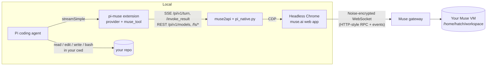
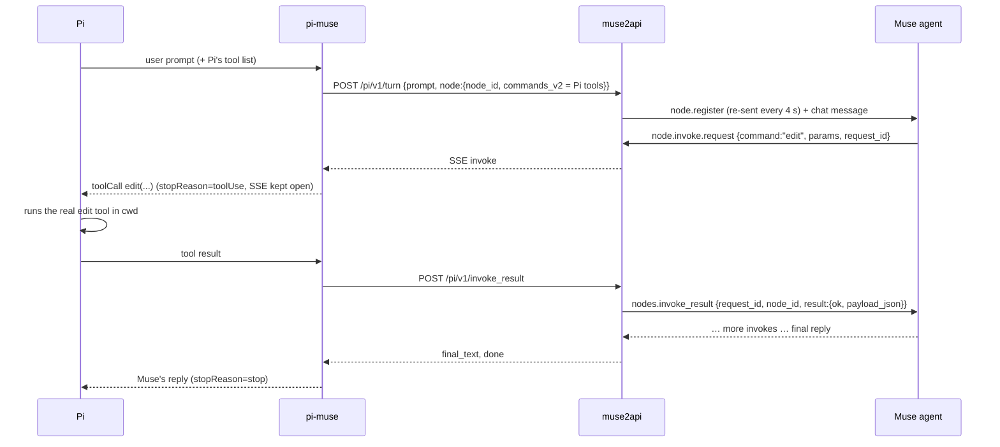
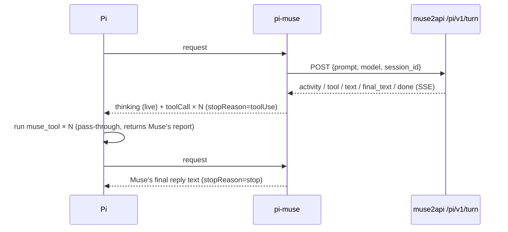

<div align="center">

# pi-muse

**Use the [Muse](https://muse.ai) agent from the [Pi coding agent](https://pi.dev) — and let it work on the repo you have open in Pi.**

[](LICENSE)
[](https://pi.dev)
[](https://pi.dev/packages)


</div>

> ⚠️ **Unofficial & reverse-engineered.** Not affiliated with muse.ai or Pi. It drives the muse.ai web app through a headless browser. It may break without notice, and it may conflict with muse.ai's Terms of Service. Use your own account, at your own risk.

---

## Why

Muse is not just a chat model. It is an **agent**: each turn runs on your own cloud workspace VM (an OpenClaw-style
workspace with `AGENTS.md`, `SOUL.md`, `MEMORY.md`, …). It runs shell commands, reads and writes files, searches memory and the web.
OpenAI-compatible wrappers hide all of that and only return text.

**pi-muse makes Muse a coding agent for your *local* repo:**

- 💻 **Local workspace by default.** Open `pi` in any repo; Muse reads, greps, edits, writes and runs commands **in that directory**, through Pi's own tools (`read`, `edit`, `write`, `bash`, `ls`, `grep`, …). You see normal Pi tool calls and diffs, and nothing has to be uploaded.
- 🔌 **How:** pi-muse registers your machine as a Muse **device node** whose commands are Pi's tools. When Muse's agent calls `device.invoke`, the request is routed to Pi, Pi runs the tool locally and the result goes back to Muse — all inside one Muse turn.
- 🧩 **Fallbacks:** an in-band **XML tool protocol** mode (`<invoke>` blocks, oh-my-pi dialect) and a **snapshot sync** mode (`/muse-push` → Muse edits a copy in its VM → `/muse-pull` diff preview → apply).
- 🧠 **Real Muse models.** The model list comes live from Muse's gateway (`auto/auto`, `ipnext/avocado-5.16-v0`, …).
- 🪞 **Mirror mode** (the original behaviour): Muse works in its own cloud VM and every VM tool call is mirrored as a Pi tool call.
- 🧵 **Thread continuity.** A Pi session stays on one Muse thread. `/muse-new` starts a fresh one.

## Modes

| Mode | Where Muse works | How | Tested (bridge-test, 3 runs each) |
|---|---|---|---|
| **`local`** (default) | your Pi cwd | Muse device node → Pi tools, results returned in the same Muse turn | 3/3 ✔, 31–39 s |
| `xml` | your Pi cwd | tool schema injected into the prompt, `<invoke>` parsed from Muse's reply, results sent as the next Muse turn | 3/3 ✔, 112–184 s |
| `sync` | a copy at `~/workspace/pi-sync/<repo>` in Muse's VM | auto `/muse-push` before the turn, diff pulled back after it (preview, or auto-apply) | 3/3 ✔, 32–68 s |
| `mirror` | Muse's own VM (`~/workspace`) | VM tool calls mirrored as `muse_tool` rows | — |

Switch with `/muse-mode <mode>`, `PI_MUSE_MODE=<mode>` or `"mode"` in `muse.json`.

## Demo

`local` mode, in a small Python repo (`pi -p --mode json`, condensed):
```text
$ cd ~/src/bridge-test && pi --model muse/auto/auto
 In mathutils.py add a function subtract(a, b) that returns a - b. Also create a new
 file test_mathutils.py containing pytest tests for add, multiply and subtract.
 ⇄ local device registered with Muse
 read mathutils.py
 edit mathutils.py            +4 lines
 write test_mathutils.py
 bash python3 -m pytest -q    3 passed
 Done. Added subtract(a, b) to mathutils.py and created test_mathutils.py with pytest
 tests for add, multiply, and subtract. All 3 tests pass.
```

`mirror` mode:
```text
 Use your shell to run: echo pi-muse > tui_demo.txt && ls | head -5
 model: Auto
 ▸ Run shell commands — Running: Executing echo and listing files
 ⚙ memory_search: Searching memory for "tui_demo.txt" (+2 variants)
 ⚙ exec: Running echo pi-muse > tui_demo.txt && ls | head -5
 ▸ Run shell commands — Finished activity: Running echo, listing files, and searching memory
 muse ▸ memory_search Memory search for "tui_demo.txt" variants returned 0 results [SUCCESS]
   No prior context found across 3 queries
 muse ▸ exec Updated tui_demo.txt and listed directory contents [SUCCESS]
   Wrote 'pi-muse' to tui_demo.txt; ls head-5 returned 5 files
 Done. The command ran successfully:
 - Created tui_demo.txt with the content pi-muse
 - First 5 entries in the directory: AGENTS.md, HEARTBEAT.md, IDENTITY.md, MEMORY.md, PROACTIVE_PREFERENCES.md
                                                                         (muse) auto/auto
```

## Architecture



How a `local`-mode turn works (one Muse turn, many Pi requests):



How a `mirror`-mode turn maps onto Pi:



- **Backend.** [muse2api](https://github.com/czg86389-hub/muse2api) already handles the headless Chrome, cookies, account pool and VM keep-alive. `backend/pi_native.py` adds `/pi/v1/*` endpoints. They call Muse's in-page gateway client (`sendRequest`) and tap decrypted gateway events.
- **Provider.** `muse/<model>` uses a custom `streamSimple`. The Muse thread id travels in `AssistantMessage.responseId` (`muse:<session_id>`), so resumed Pi sessions keep the same thread.
- **Pass-through tool.** `muse_tool` has no local side effects. It returns the result Muse already produced. Failed Muse tools show as failed Pi tool results.

The full event shapes are in [docs/PROTOCOL.md](docs/PROTOCOL.md).

## Quick start

**Prerequisites:** Pi ≥ 1.1, Node ≥ 20, a running muse2api with at least one muse.ai account imported.

```bash
# 1. Backend: add the pi-native endpoints to muse2api (see backend/README.md)
cd muse2api && git checkout -b pi-native
cp ../pi-muse/backend/pi_native.py . && git apply ../pi-muse/backend/muse2api-app.patch
# restart muse2api

# 2. Configure (or use the env vars MUSE2API_URL / MUSE2API_KEY)
cp pi-muse/examples/muse.example.json ~/.pi/agent/muse.json && chmod 600 ~/.pi/agent/muse.json
$EDITOR ~/.pi/agent/muse.json

# 3. Install the extension
pi install ./pi-muse            # or: pi install git:github.com/thoitiettxl-cyber/pi-muse
pi --list-models | grep muse

# 4. Go: open Pi in the repo you want Muse to work on
cd ~/src/my-project && pi --model muse/auto/auto
```

## Usage

| | |
|---|---|
| `pi --model muse/auto/auto` | Muse "Auto" router |
| `pi --model muse/ipnext/avocado-5.16-v0` | pin a specific Muse model (selection is restored after the turn) |
| `/muse-mode [local\|xml\|sync\|mirror]` | show / switch how Muse reaches your files (switching starts a new thread) |
| `/muse-push` | upload a snapshot of the repo (`git ls-files -co --exclude-standard`, ≤2 MB/file) to `~/workspace/pi-sync/<repo>` |
| `/muse-pull [--yes]` | show a unified diff of what Muse changed in that copy; confirm to apply |
| `/muse-apply` | apply those changes without asking |
| `/muse-unsync` | delete the snapshot folder from the Muse VM |
| `/muse-new` | next prompt starts a new Muse thread |
| `/muse-ls [path]` | list the VM (default `workspace`, relative to `/home/hatch`) |
| `/muse-sync [remote] [localDir]` | download files (≤5 MB each, ≤500 entries) into `./muse-workspace` |
| `Ctrl+O` | expand a `muse ▸ …` row to read Muse's full tool report |

Non-interactive: `pi -p --model muse/auto/auto "…" < /dev/null` (or `--mode json` to get `tool_execution_*` events).

## Configuration

| Env var | `muse.json` key | Default |
|---|---|---|
| `MUSE2API_URL` | `baseUrl` | `http://127.0.0.1:18610` |
| `MUSE2API_KEY` | `apiKey` | — |
| `PI_MUSE_MODE` | `mode` | `local` (`xml`, `sync`, `mirror`) |
| `PI_MUSE_SYNC_AUTO_APPLY=1` | `syncAutoApply` | `false`: in `sync` mode apply Muse's changes right after the turn instead of waiting for `/muse-pull` / `/muse-apply` |
| `PI_MUSE_SETTLE_TIMEOUT` | `settleTimeout` | `45` seconds to wait for Muse's post-reply tool reports |
| `PI_MUSE_CONFIG` | | `~/.pi/agent/muse.json` |
| `PI_MUSE_OFFLINE=1` | | skip live model discovery at startup |
| `PI_MUSE_MODELS_TIMEOUT_MS` | | `60000` |
| `PI_MUSE_DUMP=/path.json` | | debug: write each `local`-mode turn payload sent to muse2api to this file |

## Pi context forwarding (`local` mode)

Muse sees the same standing context a native Pi model gets:

| Item | How it reaches Muse |
|---|---|
| Pi system prompt (base prompt, tool guidelines, `SYSTEM.md` / `APPEND_SYSTEM.md`, extension prompt sections) | Replayed from the transcript's system messages (leading prompt + named section patches) and sent inside `<pi_system_prompt>` |
| `AGENTS.md` / `CLAUDE.md` (global `~/.pi/agent/AGENTS.md` + every ancestor dir of the cwd) | Part of Pi's `project_context` section |
| Skills (`~/.pi/agent/skills`, `~/.agents/skills`, project `.pi/skills` / `.agents/skills`, packages) | Pi's skills index with absolute `SKILL.md` locations; Muse loads a skill on demand with the device `read` command |
| Prompt templates / `/skill:` commands | Expanded by Pi into the user message, which is forwarded as is |
| Extension tools | Registered as Muse device commands (name, description, parameters) |
| Conversation history | Muse keeps its own thread; when a new Muse thread starts mid-session (e.g. after `/muse-new` or a mode switch) a compact transcript of earlier Pi turns is sent once |

The system prompt is sent on the first turn of a Muse thread and again only when it changes (a hash is stored in
the assistant message's `responseId` as `muse:<thread>#ctx=<hash>`), so follow-up turns stay small.

## Limitations

- **`local` mode runs Muse's commands on your machine.** Every `bash` / `write` / `edit` Muse asks for is executed by Pi in your cwd with your user's rights, exactly like any other Pi model. Use it on repos you are happy to let an agent change, and keep them under git.
- **Muse decides whether to use the device.** pi-muse prepends a short instruction ("the project lives only on device …; use its commands, not your VM") to each prompt. In tests Muse followed it every time, but it is a prompt, not a guarantee; Muse may also use its own memory/web tools, which show up in the thinking block.
- **The device exists only during a turn.** muse2api opens the muse.ai page per turn, so the node is online only while Pi is waiting on Muse. Between turns it shows as offline in Muse's device list. Muse's node-invoke timeout is about 30 s per call, so very long `bash` commands can time out on Muse's side even though they finish locally.
- **One machine, one node.** The node id is `pi-<hostname>`; the display name carries the repo name. Two Pi sessions on one machine at the same time would share it (muse2api serializes turns anyway).
- **`xml` mode is slow.** Every tool round-trip is a full Muse turn (~25–30 s), and long tool outputs are pasted into the chat.
- **`sync` mode copies files.** Files up to 2 MB from `git ls-files`, nothing ignored, no `.git`. Changes made locally after `/muse-push` are reported as conflicts and not auto-applied. Muse sometimes needs its VM tools to be reminded to stay inside `~/workspace/pi-sync/<repo>`.
- **Mirror mode only sees tool summaries.** The web client never receives raw tool names, arguments or stdout. Tool names are inferred and match OpenClaw's core tools.
- **Context forwarding is `local` mode only.** `xml`, `sync` and `mirror` still send only the latest user message (plus their preamble).
- **One browser, one turn at a time.** muse2api serializes turns. Expect several seconds of page setup per turn.
- **Model selection is account-wide on Muse.** pi-muse restores the previous model after each turn.
- **No image input, no usage/cost numbers.**
- **Fragile by nature.** UI and gateway changes on muse.ai can break it. Check `docs/PROTOCOL.md` and open an issue.

## Disclaimer

This project is an independent, unofficial interoperability experiment built by observing the muse.ai web client. It is not endorsed by muse.ai, Meta, OpenClaw or Earendil/Pi. Do not use it to abuse quotas, scrape other users' data or bypass access controls. Respect muse.ai's terms. You are responsible for how you use it.

## Credits

- [**muse2api**](https://github.com/czg86389-hub/muse2api) by **czg86389-hub** (MIT) provides the headless-browser and session layer this builds on.
- [**OpenClaw**](https://github.com/openclaw/openclaw) documents the agent/workspace model (AGENTS.md, SOUL.md, core tools) that helped decode Muse's activity events.
- [**oh-my-pi**](https://github.com/can1357/oh-my-pi) (MIT): the XML tool-call dialect in `src/xml-dialect.ts` (prompt rules, schema coercion, `<tool_response>` rendering) is adapted from its `packages/ai/src/dialect`. See [THIRD_PARTY_NOTICES.md](THIRD_PARTY_NOTICES.md).
- [**Pi**](https://pi.dev) supplies the extension, provider and tool-rendering APIs.

## License

[MIT](LICENSE)
